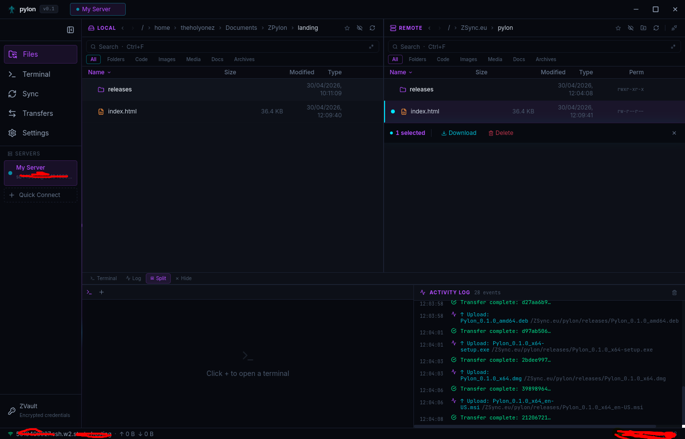
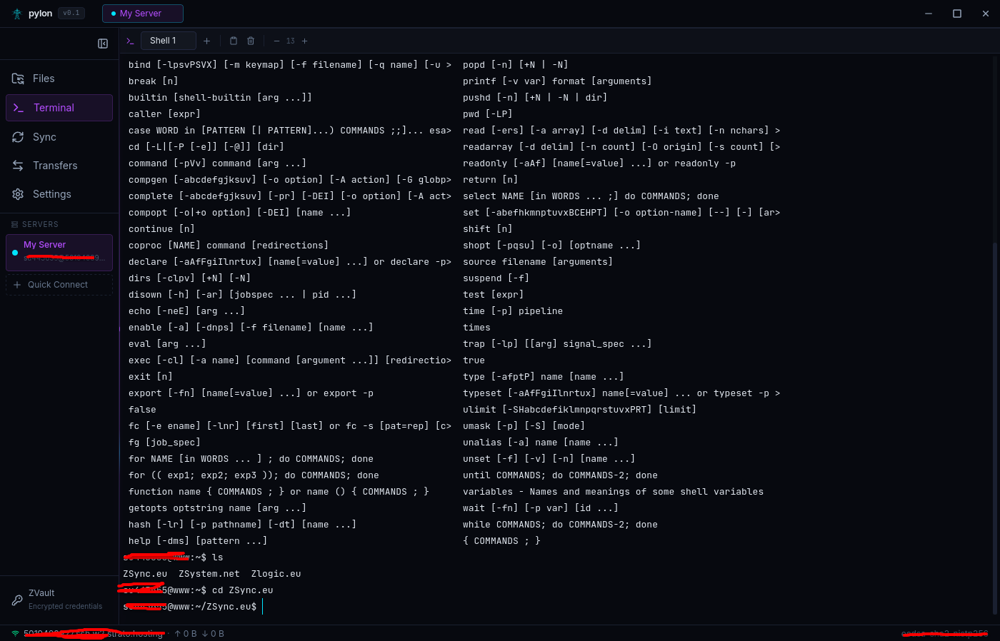
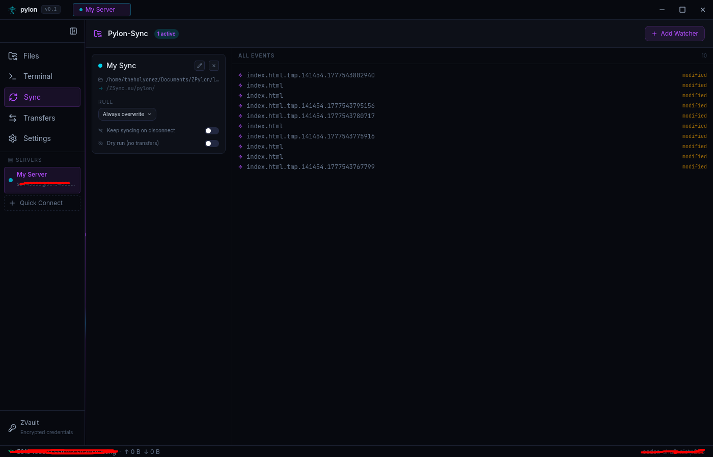
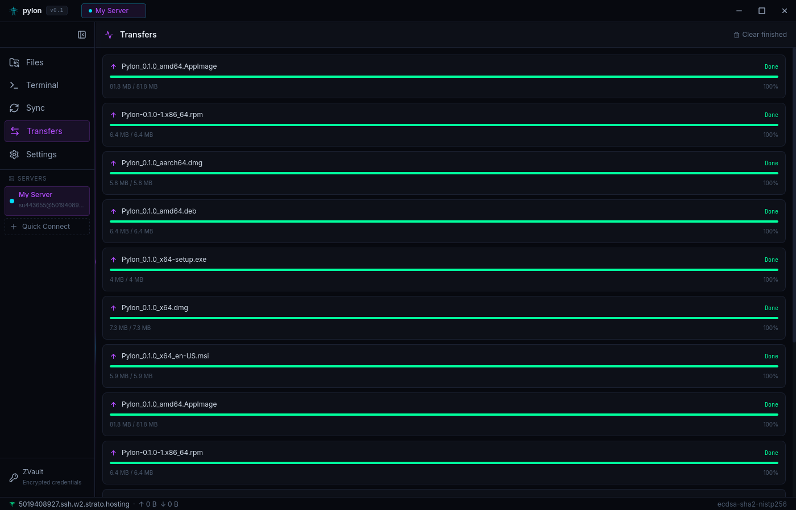
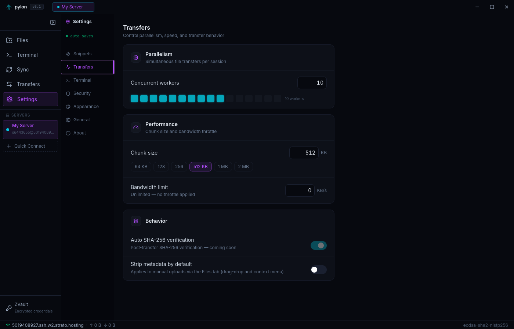
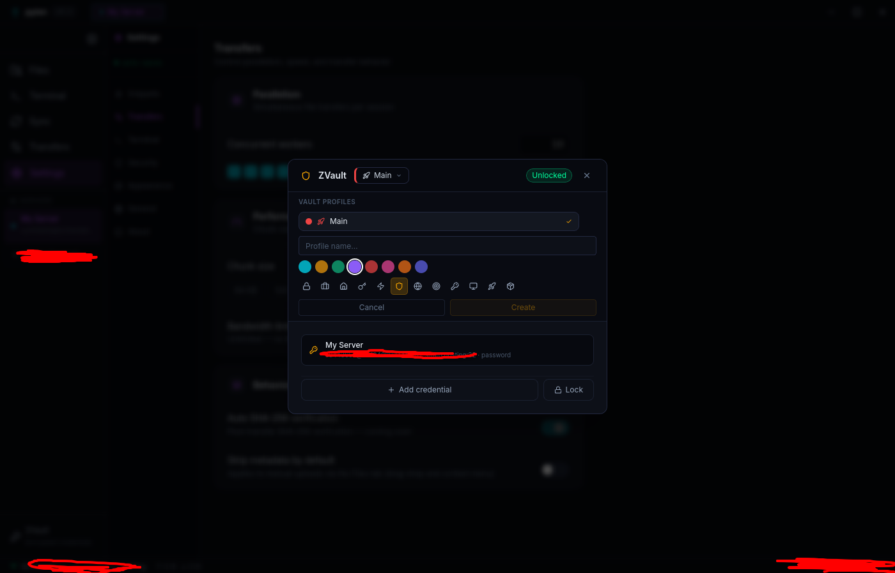

# Pylon

Cross-platform SSH and SFTP desktop client built with [Tauri v2](https://tauri.app), Rust, and React.

**License:** GPL-3.0 | **Version:** 0.3.0 (beta) | **Platforms:** Windows, macOS, Linux

> Pylon is in beta. The vault format and configuration schema may change between pre-release versions. Back up your vault before upgrading.

---

## Download

### **[→ zsync.eu/pylon](https://zsync.eu/pylon/)**

Windows, macOS (Apple Silicon + Intel), and Linux — all builds available on the website. No account required. Free and open source under GPL-3.0.

> **macOS:** Not yet notarized. Right-click the `.app` → Open → confirm in the security dialog on first launch.

---

## Screenshots

| Files | Terminal |
|---|---|
|  |  |

| Sync | Transfers |
|---|---|
|  |  |

| Settings | ZVault |
|---|---|
|  |  |

---

## Features

### File Management

- Dual-pane browser: local filesystem on the left, remote SFTP on the right, resizable
- Multi-select with Shift+Click (range), Ctrl+Click (individual), Ctrl+A (all)
- Drag-and-drop between panes, onto folders (move), and from the OS file manager
- Full keyboard navigation (arrows, Home/End, PageUp/Down, type-ahead, Tab to switch panes)
- Context menu with full file operations and shortcut hints
- Sortable columns (name, size, modified, permissions); columns collapse on narrow panes
- Editable path bar (Ctrl+L), click-to-navigate breadcrumb, bookmarks
- Windows drive letters, hidden files and symlinks handled on every platform
- Regex and type filter per pane
- Remote chmod editor
- Panes refresh automatically when a transfer finishes in the folder you're looking at

### Transfer Engine

- Real resume: a failed or dropped transfer keeps its partial file (`.name.<id>.pylon-part`)
  and continues from where it stopped — also across app restarts and reconnects
- Atomic writes: the destination is only replaced once the copy is complete
- SHA-256 verification against `sha256sum`/`shasum` on the server for files ≥ 1 MB;
  a mismatch fails the transfer instead of leaving a silently corrupt file
- Live speed and ETA in the transfer drawer (Ctrl+J), with a "Verified" badge
- Pause, resume, cancel (removes the partial) and retry per transfer
- Concurrent workers (1–16) for folder transfers
- Optional bandwidth limit (KB/s), applied live; pausing doesn't cause a catch-up burst
- Recursive folder upload/download, including empty folders
- Remote permissions preserved on overwrite; local modification times preserved on download
- Overwrite policy: ask / overwrite all / skip all
- Clear errors ("connection to the server was lost") instead of raw libssh2 messages

### SSH Terminal

- xterm.js 5 with truecolor, Unicode 11 widths and clickable links
- Multiple tabs per session (rename with double-click); scrollback survives switching tabs
- Your login shell by default, or a specific shell (bash, zsh, fish, sh)
- Optional: navigating the remote pane `cd`s the active terminal
- Command snippets toolbar
- Plain Ctrl+<key> always goes to the shell (Ctrl+D, Ctrl+K, Ctrl+L…); app shortcuts use Ctrl+Shift
- Idle terminals use no CPU

### ZVault — Credential Manager

- AES-256-GCM encryption for every stored credential
- One Argon2id key derivation per unlock (m=64 MiB, t=3, p=4) with a random per-vault salt
- Vault format v3; v1/v2 vaults are migrated automatically (a backup is kept)
- Unlock is all-or-nothing, and a damaged vault file is never overwritten
- Auto-lock after a configurable idle time; change the passphrase at any time
- Stores passwords, private keys (path or pasted text) and key passphrases
- Optional auto-reconnect for saved servers when a connection drops

### Sync Watchers

- Watch a local directory and push changes to a remote path over SFTP
- Powered by the `notify` crate (inotify / FSEvents / ReadDirectoryChangesW)
- Creates, edits, renames and (optionally) deletes, including nested folders
- 250 ms debounce to coalesce rapid saves; uploads go to a temp file and are renamed into place
- `.syncignore` and `.gitignore` (gitignore syntax) respected; `.git/` is always ignored
- Optional permission mirroring, max file size, protected remote paths, dry-run mode
- Keep-on-disconnect: watchers resume automatically when the server reconnects
- Overwrite rules: always overwrite / new files only / update existing / confirm on overwrite / confirm all

### Metadata Stripping

Strip privacy-sensitive metadata in-flight on upload, or on-demand via context menu.

| Format | Stripped |
|---|---|
| JPEG / PNG / WebP / GIF | EXIF, XMP, comments, text chunks — removed losslessly (pixels, ICC colour profile and GIF animation are untouched) |
| PDF | Author, creator, producer, keywords, XMP metadata |

Enable globally in Settings → Security, or trigger per-file from the context menu.

### Security

- Host keys verified against `~/.ssh/known_hosts`, including hashed (`|1|`) entries,
  wildcards, `@revoked` and per-key-type entries
- The fingerprint you approve is the one the connection is pinned to
- Host key policy: ask / accept new / strict — a *changed* key always asks
- Dropped connections are detected within about a second during activity (≈30 s when idle)
- No telemetry; no outbound connections beyond what you explicitly initiate
- Strict Content-Security-Policy; devtools only when `PYLON_DEVTOOLS=1`
- Optional app lock (PBKDF2-SHA256). It locks the window; your credentials are protected by ZVault encryption

### Other

- Command palette (Ctrl+K)
- Activity log
- Seven colour themes
- Keyboard shortcuts for all major actions (⌘ instead of Ctrl on macOS)
- Bookmarks for local and remote paths

---

## Building

### Prerequisites

| Tool | Required version |
|---|---|
| Rust | stable ≥ 1.77 |
| Node.js | ≥ 20 LTS |
| pnpm | ≥ 9 |

**Windows** — OpenSSL is compiled from source (vendored), which needs Perl:

1. Download [Strawberry Perl portable](https://strawberryperl.com/) and extract to `C:\strawberry-perl`
2. Add the following to your **system** PATH (Settings → System → Advanced system settings → Environment Variables → Path):
   - `C:\strawberry-perl\perl\bin`
   - `C:\strawberry-perl\c\bin`

Without Perl, `cargo build` will fail with `Command 'perl' not found` during the `openssl-sys` compilation step.

**Linux** — install WebKit2GTK and related system libraries:

```bash
# Debian / Ubuntu
sudo apt-get install -y libwebkit2gtk-4.1-dev libappindicator3-dev librsvg2-dev patchelf

# Fedora / RHEL
sudo dnf install webkit2gtk4.1-devel libappindicator-gtk3-devel librsvg2-devel
```

**macOS** — Xcode Command Line Tools:

```bash
xcode-select --install
```

### Dev

```bash
pnpm install
pnpm tauri dev
```

Frontend only (no Rust compilation, faster iteration):

```bash
pnpm dev
```

Verbose Rust logging:

```bash
RUST_LOG=debug pnpm tauri dev
```

### Release build

```bash
pnpm install
pnpm tauri build
```

Artifacts are placed in `target/release/bundle/` (the repository is a Cargo workspace,
so the target directory is at the root).

### Tests

```bash
cargo test -p pylon --no-default-features          # unit tests
npx tsc --noEmit                                    # frontend type check

# SSH integration tests against a real sshd (skipped unless the variable is set):
# PYLON_TEST_SSH="host:port:user:/dir/with/test/keys"
PYLON_TEST_SSH=127.0.0.1:2222:$USER:/path/to/keys cargo test -p pylon --no-default-features --test ssh_integration
```

---

## Keyboard Shortcuts

On macOS use ⌘ wherever Ctrl is listed.

### Global

| Shortcut | Action |
|---|---|
| Ctrl+K | Command palette |
| Ctrl+N | New connection |
| Ctrl+J / Ctrl+T | Toggle transfer drawer |
| Ctrl+Shift+D | Disconnect active session |
| Ctrl+1 … Ctrl+4 | Files / Terminal / Sync / Transfers |
| Ctrl+B | Toggle sidebar |
| Ctrl+` | Toggle the bottom terminal panel |
| Ctrl+, | Settings |

### File browser

| Shortcut | Action |
|---|---|
| ↑ ↓ Home End PgUp PgDn | Move cursor (add Shift to extend the selection) |
| Enter | Open folder / open file |
| Ctrl+Enter | Upload / download the selection to the other pane |
| Backspace or Alt+↑ | Up one folder |
| Tab | Switch between local and remote pane |
| F2 | Rename |
| Delete | Delete |
| Ctrl+Shift+N | New folder |
| Ctrl+A | Select all |
| Ctrl+F or / | Filter |
| Ctrl+L | Edit path |
| F5 or Ctrl+R | Refresh |
| Type letters | Jump to a matching name |

### Terminal

| Shortcut | Action |
|---|---|
| Ctrl+Shift+T | New terminal tab |
| Ctrl+Shift+C | Copy selection |
| Ctrl+Shift+V | Paste |

---

## Tech Stack

**Frontend:** React 18, TypeScript 5, Vite 5, Tailwind CSS 3 (theme tokens as CSS variables), Zustand, Framer Motion, @xterm/xterm 5, Lucide React, react-resizable-panels; Inter and JetBrains Mono bundled (no font CDN)

**Backend (Rust):** tauri 2, ssh2 (vendored OpenSSL), tokio, aes-gcm, argon2, notify, kamadak-exif, lopdf, sha2, hmac/sha1 (hashed known_hosts), ignore, serde, thiserror, tracing

---

## Vault file location

| Platform | Path |
|---|---|
| Linux | `~/.config/pylon/vault-default.json` |
| macOS | `~/Library/Application Support/pylon/vault-default.json` |
| Windows | `%APPDATA%\pylon\vault-default.json` |

If you forget your master password there is no recovery mechanism. The vault cannot be decrypted without the correct passphrase.

---

## macOS note

Pylon is not yet notarized by Apple. On first launch, right-click the `.app` and choose Open, then confirm in the security dialog.

---

## License

GNU General Public License v3.0. See [LICENSE](LICENSE).
